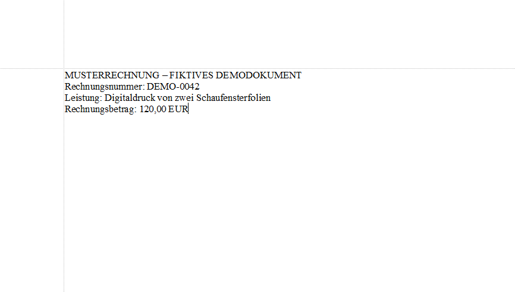
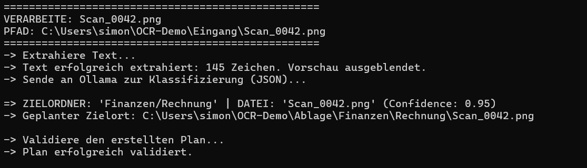
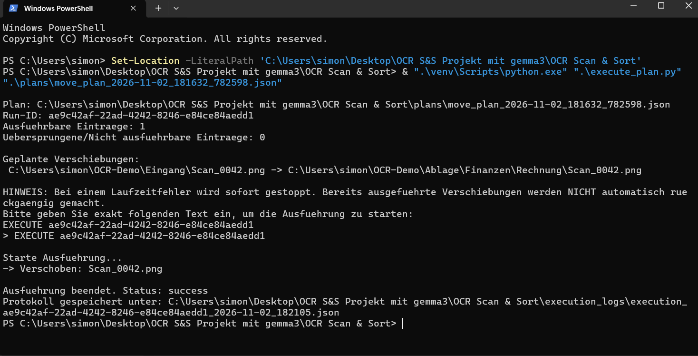
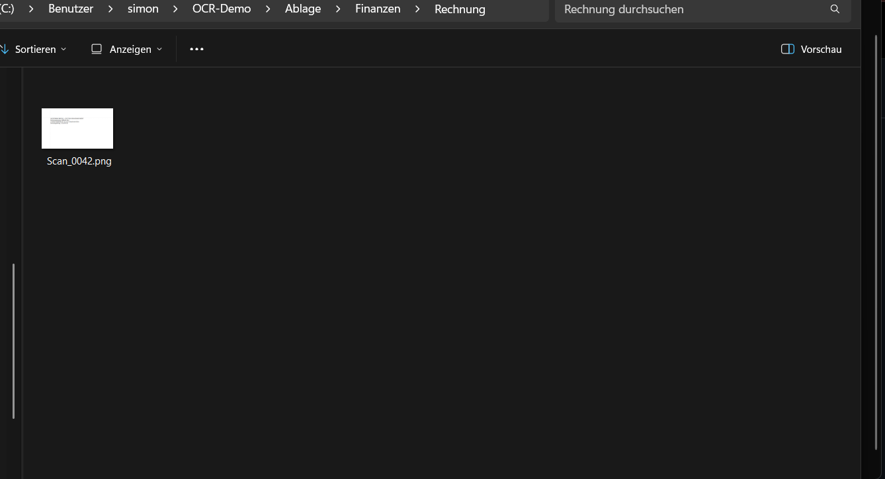

# ocr-scan-sort-demo
Lokale Dokumentensortierung mit OCR und Gemma 3 – vom Ablagevorschlag bis zur manuellen Freigabe

## Demo: Vom Scan zur abgelegten Rechnung

**1. Eingang:** Der Dateiname `Scan_0042.png` verrät nicht, was das
Dokument enthält. Für diesen Test habe ich eine fiktive Rechnung
über den Digitaldruck von zwei Schaufensterfolien verwendet.

**2. Vorschlag:** Die Texterkennung liest 145 Zeichen aus dem Bild.
Gemma 3 schlägt `Finanzen/Rechnung` vor. Zu diesem Zeitpunkt
liegt die Datei noch im Eingangsordner.

**3. Freigabe:** Ich prüfe den Vorschlag und bestätige diesen Lauf
in PowerShell. Erst danach verschiebt das Programm die Datei.

**4. Ergebnis:** Im Zielordner `Ablage/Finanzen/Rechnung` liegt
jetzt die Datei `Scan_0042.png`.

